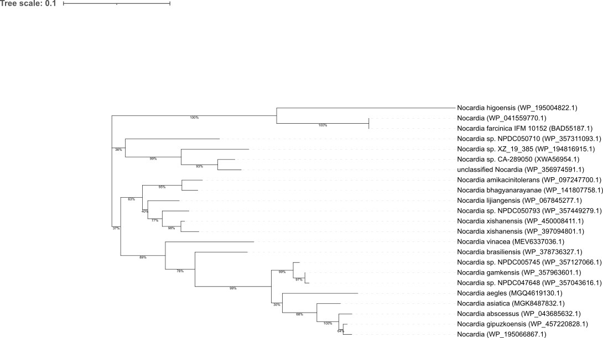

# Phylogeny of an MBL-fold hydrolase family in *Nocardia*

A small practice project: building a maximum-likelihood protein phylogeny from public sequences, using the same kind of workflow applied to study gene evolution and horizontal gene transfer in bacteria.

## Question

How does a metallo-beta-lactamase (MBL) fold hydrolase from *Nocardia farcinica* vary across *Nocardia* species, and which groupings are well supported?

> Note: "MBL fold" is a large protein superfamily. It includes metallo-beta-lactamases but also many enzymes unrelated to antibiotic resistance. The sequences here are annotated only as "MBL fold metallo-hydrolase" / "putative hydrolase", so no resistance function is claimed.

## Data

- **Query:** BAD55187.1, putative hydrolase, *Nocardia farcinica* IFM 10152 (NCBI Protein).
- **Homologs:** BLASTp (NCBI web, `nr` database). 23 sequences were kept, all from *Nocardia* species.

## Workflow

```bash
# 1. Environment
conda create -n phylo -c conda-forge -c bioconda raxml-ng mafft
conda activate phylo

# 2. Clean line endings (file downloaded on Windows)
sed -i 's/\r$//' seqs.fasta

# 3. Multiple sequence alignment
mafft --auto seqs.fasta > aln.fasta

# 4. Check the alignment, then infer the ML tree with 100 bootstrap replicates
raxml-ng --check --msa aln.fasta --model LG+G
raxml-ng --all --msa aln.fasta --model LG+G --bs-trees 100 --threads 2 --seed 42
```

- **Model:** LG+G (LG amino-acid substitution matrix with gamma-distributed rate variation among sites).
- **Visualisation:** iTOL, with tips relabelled by species using `labels.txt`.

## Files

| File | Content |
|---|---|
| `seqs.fasta` | Input protein sequences |
| `aln.fasta` | MAFFT alignment |
| `aln.fasta.raxml.support` | Best ML tree with bootstrap support values (Newick) |
| `aln.fasta.raxml.log` | RAxML-NG run log |
| `labels.txt` | iTOL label file (accession → species) |
| `tree.png` | Tree figure exported from iTOL |

## Results



- Several clades are strongly supported (bootstrap ≥ 95%), e.g. the *N. farcinica* / *N. higoensis* group and the *N. abscessus* / *N. gipuzkoensis* group.
- Deep branches have low support (around 35–40%), so the relationships between the main groups are not resolved.
- The query sequence (*N. farcinica*) falls on a long branch with only two other sequences, suggesting most hits may be related but distinct members (possibly paralogs) of the same family.
- *N. xishanensis* contributes two sequences, consistent with gene duplication within that species.

## Limitations and next steps

- Unrooted tree: no outgroup was included, so the root shown is arbitrary. Next step: add homologs from other Actinobacteria (e.g. *Rhodococcus*, *Mycobacterium*) as an outgroup.
- A single gene tree cannot show horizontal gene transfer on its own. It would need to be compared with a species tree (e.g. from 16S rRNA or core genes); strongly supported conflicts between the two would suggest transfer.
- Repeat the analysis with a characterised *Nocardia* beta-lactamase to study an actual resistance gene.

## Tools

MAFFT, RAxML-NG, iTOL, NCBI BLASTp.
